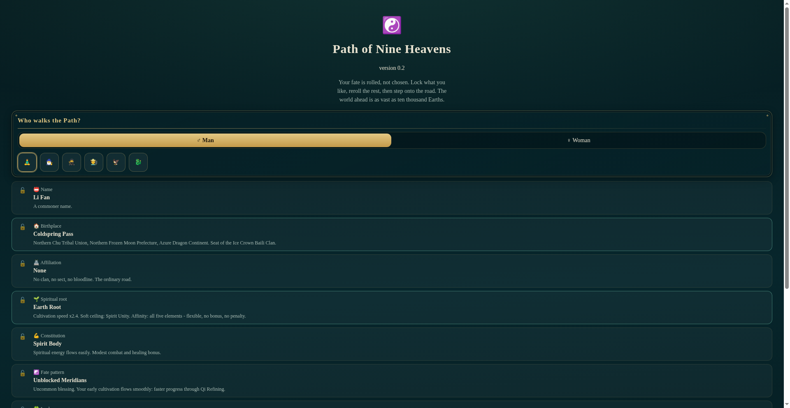

# ☁️ Path of Nine Heavens

A text-based xianxia life sim for browser and Android. Your fate is rolled, not chosen - lock the rolls you like, reroll the rest, then step onto the road.



## 🎮 Play

- **Browser (current version):** https://zeux67.github.io/path-of-nine-heavens/
- **Android:** APKs are attached to each [GitHub Release](https://github.com/zeux67/path-of-nine-heavens/releases)
- **Every old version** is playable in the browser from the [version archive](https://zeux67.github.io/path-of-nine-heavens/archive/)

## 🌄 The game

One life, from a commoner with a rolled root to the Nine Heavens - if you live that long. Cultivation here is measured in months and years, the world does not wait for you, and every step up has a price.

### 🎲 A fate rolled, not chosen

Every life starts at the reroll table: name, birthplace, family, spirit root, fate, luck, alignment - lock the rolls you like, reroll the rest. Born with a Mortal Root, and the road to immortality looks closed? A very rare twist of fate can still rewrite it - if you survive the attempt.

### 🧘 The long road up

Shut your cave doors for a season or a century. You get a projection before you go in, and a full report when you come out: what changed for you, your people, your sect or clan, the world, the market, the danger. Major breakthroughs are guarded - first your heart-demon wakes and speaks in your own voice, then heaven's lightning, which grows with everything heaven has noticed about you. Fail the tribulation and it scars you: slower qi, a shorter life.

### 🎭 A world that moves without you

Random events shaped by your role, alignment, realm and crafts. Karma keeps a ledger on your righteous or demonic nature, and the same deed weighs differently on each. Secret realms, inheritance caves, wounded cultivators and hidden markets wait on the road; plagues, bandit raids and beast tides hit where you live. A hidden cave, or a guard puppet at your door, can be the difference. Friends spill rumors over wine; close friends trade pointers that move your cultivation.

### 🔥 Affinity and craft

Elements decide which spells and techniques suit you, and a rare few are born with a Heavenly Affinity. The crafts are open to any cultivator willing to pay a teacher or study a manual: alchemy, refining, talismans, formations, beast taming, spirit farming, geomancy, divination, puppetry, poison and gu. Farm plots and mining puppets earn while you cultivate, a guard puppet stands before you in every fight, and a bonded beast grows at your side. The World Market shows real stock in every town this month - but you can only buy in person, so the road matters.

## 📦 Releases and changelog

Each version has its own [GitHub Release](https://github.com/zeux67/path-of-nine-heavens/releases) with its notes in one format (NEW / CHANGED / FIXES) and its Android APK. The full history is also in [CHANGELOG.md](CHANGELOG.md).

## 🛠️ Source and building

`src/` is the released 0.2 game source (React + TypeScript). See [PROVENANCE.md](PROVENANCE.md) for exactly what was recovered and what was reconstructed; `source-manifest.json` lists per-file hashes against the original archive.

Build the browser version (the packaging config here is a labeled reconstruction - the original build setup was not part of the recovered archive):

```
npm install
npm run build
```

This produces a single self-contained `dist/index.html` you can open or host anywhere. `npm run dev` starts a local dev server.

## 💾 Saves

Saves are stored locally in your browser or app. To move a save between devices or versions, use Settings - This life - Back up or restore in the game.

## 🗂️ Repository layout

- `src/` - released 0.2 game source (a sanitized standalone browser port; the Android wrapper and original build setup are not part of this repo).
- `index.html`, `vite.config.ts`, `package.json`, `tsconfig.json` - reconstructed browser packaging.
- `CHANGELOG.md` - the full player-facing changelog.
- `docs/` - screenshots and documentation images.
- The `gh-pages` branch carries the hosted playable builds (current + archive); it is generated, not source.

## ✒️ Credits

Made by Zeux.
